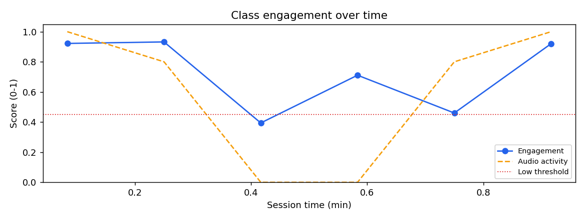
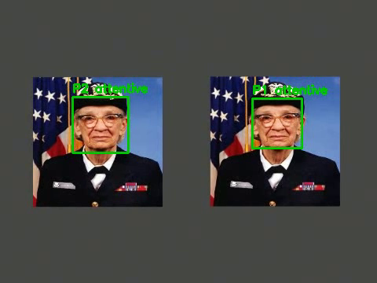

# Multimodal Attendance & Engagement Agent

An AI-powered, **offline and privacy-preserving** classroom intelligence system. It fuses
**computer vision**, **audio signal processing** and **rule-based agent reasoning** to

1. mark attendance from *sustained* presence (not single-frame detection) with timestamped logs,
2. analyse engagement over time from head pose, movement, inactivity duration and audio activity,
3. give assistive, explainable teaching suggestions to the instructor,
4. produce session analytics for every student.

> SkillWallet capstone - *Generative AI with Google Cloud*. No face images or speech content are stored or
> sent anywhere: the system keeps only numeric signals and CSV/JSON reports. The audio module never does
> speech recognition - only loudness and speech-activity (noise level, talking vs. silence).

## How the project maps to the SkillWallet epics

| Epic | Activity | Where it lives |
|------|----------|----------------|
| 1 Requirements & environment | 1.1 `requirements.txt` | `requirements.txt` |
| | 1.2 libraries + virtual env | `setup.bat`, `setup.sh`, `scripts/check_env.py` |
| 2 Vision module | 2.1 face detection & tracking | `src/maea/vision.py` (Haar frontal+profile, CLAHE lighting fix, centroid tracker, seat re-ID) |
| | 2.2 presence-based attendance | `fusion.build_attendance` (sustained presence, flicker rejection) |
| 3 Audio module | 3.1 audio signal extraction | `src/maea/audio.py` (`extract_wav`, ffmpeg, 16 kHz mono) |
| | 3.2 noise & speech activity | `audio.analyse_audio`, `fusion.audio_windows` (dBFS level, Quiet/Moderate/Noisy, speech ratio) |
| 4 AI implementation | 4.1 multimodal agent | `src/maea/agent.py`, `src/maea/pipeline.py` |
| | 4.2 multimodal signal fusion | `fusion.build_engagement` |
| | 4.3 engagement scoring | `fusion.score_components`, `fusion.explain` (explainable) |
| 5 Analytics & recommendation | 5.1 teaching suggestion logic | `agent.reason` |
| | 5.2 student session analytics | `fusion.build_student_summary` -> `student_session_analytics.csv` |
| 6 Interface, testing, deployment | 6.1 run core app | `python main.py --video ...` |
| | 6.2 optional Streamlit dashboard | `streamlit run app.py` |
| | 6.3 validate outputs & edge cases | `tests/test_core.py`, `scripts/validate_edge_cases.py` -> `docs/validation_report.md` |

## Architecture

```
video ─► Vision ─► face detect (Haar frontal + profile, CLAHE) ─► tracker (+ seat re-identification)
                    └─► per sample: facing camera? , movement
   └──► Audio  ─► ffmpeg 16 kHz wav ─► frame energy ─► speech activity + noise level (dBFS)
                                   │
                    Fusion (10 s windows): attention · presence · movement/inactivity · audio
                                   │
              Explainable score  =  0.55·attention + 0.15·presence + 0.15·movement + 0.15·audio
                                   │
        Agent (rule-based reasoning, optional Gemini polish) ─► findings + suggestions
                                   │
        CSV / JSON / PNG reports · student analytics · annotated video · Streamlit dashboard
```

Anyone counted as attending but absent in a window scores 0 for that window, so people leaving
lowers class engagement. Every score comes with a plain-language explanation
(e.g. *"often looking away; very little movement; little audio interaction"*).

## Setup (Activity 1.2)

Windows: double-click or run `setup.bat`.  Linux/macOS: `bash setup.sh`.  Manually:

```bash
python -m venv .venv
.venv\Scripts\activate            # Linux/macOS: source .venv/bin/activate
pip install -r requirements.txt
python scripts/check_env.py
```
`ffmpeg` is needed to read the audio of a video (`winget install ffmpeg` on Windows). Without it the
system still runs in vision-only mode.

## Run

```bash
python scripts/make_sample.py                                # creates sample_data/demo.mp4 (already included)
python main.py --video sample_data/demo.mp4 --annotate       # core app -> outputs/
streamlit run app.py                                         # dashboard
python scripts/validate_edge_cases.py                        # edge-case validation -> docs/validation_report.md
pytest                                                       # unit tests
```

Use your own classroom recording with `--video path/to/class.mp4` (use `--audio file.wav` if the audio is separate).
Optional: set `GEMINI_API_KEY` and add `--use-gemini` to have Gemini rephrase the suggestions (cloud call, off by default).

## Outputs

| File | Content |
|------|---------|
| `attendance.csv` | participant, first/last seen, seconds present, status |
| `engagement_timeline.csv` | per window: engagement, audio activity, noise level, notes |
| `participant_sessions.csv` | per participant per window: component scores + explanation |
| `student_session_analytics.csv` | per student: averages, best/lowest window, longest still stretch, feedback |
| `report.json`, `engagement.png`, `annotated.mp4` | summary, chart, video with boxes and labels |

Ready-made example outputs are in `results/`.

## Results on the bundled demo clip

A 60 s synthetic classroom (two participants): P-right leaves 20-38 s, P-left turns away 40-50 s, teacher
speaks 0-18 s and 42-60 s. The agent flags attention drops at 00:00:20 ("Not in frame: ...") and
00:00:40, a declining trend, and suggests re-engagement activities.




Validation: `docs/validation_report.md` (9/9 edge cases: missing/corrupt file, empty room, no audio,
very short video, silent audio, loud noise, low light, reference session). Unit tests: 10 passing.

## Limitations and ethics

- Haar-cascade detection is lightweight but weaker than deep models in poor light, with tiny faces or heavy occlusion.
  "Attention" is a proxy (facing the camera), not a measure of understanding.
- The bundled demo is **synthetic** (a stock photo stands in for faces). Validate on real recorded sessions, with consent.
- Participants are anonymous IDs (P1, P2...) re-identified by seat position - no face recognition.
- Suggestions are assistive decision support only; the instructor decides.

## References

- P. Viola, M. Jones, "Rapid Object Detection using a Boosted Cascade of Simple Features," CVPR 2001.
- R. Lienhart, J. Maydt, "An Extended Set of Haar-like Features for Rapid Object Detection," ICIP 2002.
- G. Bradski, "The OpenCV Library," Dr. Dobb's Journal of Software Tools, 2000.
- OpenCV documentation (Cascade Classifier, CLAHE); Streamlit documentation; FFmpeg documentation.

## Future work
Deep detectors (MediaPipe / YOLO face + landmarks for true head pose), real student roster mapping,
multi-camera classrooms, LMS integration.
